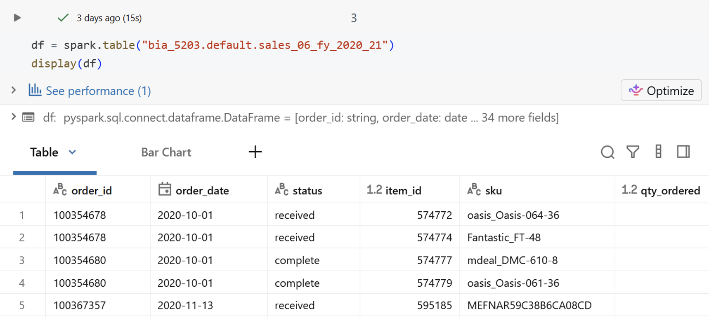
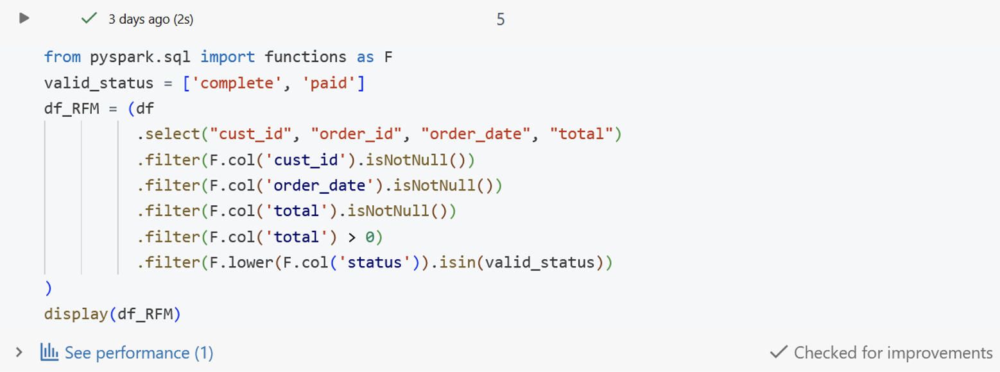
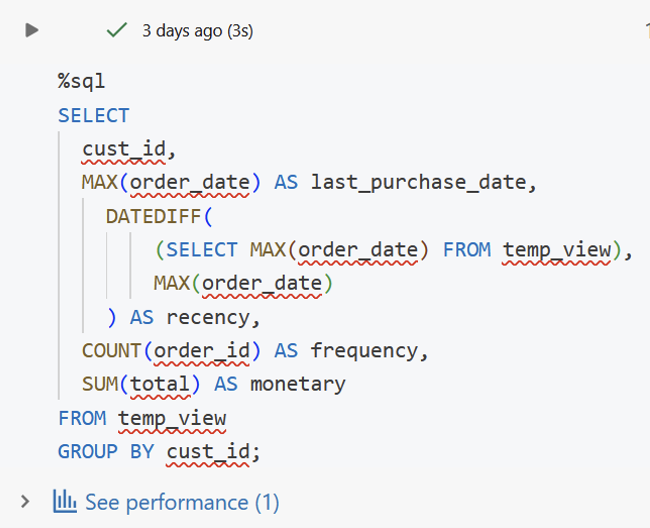
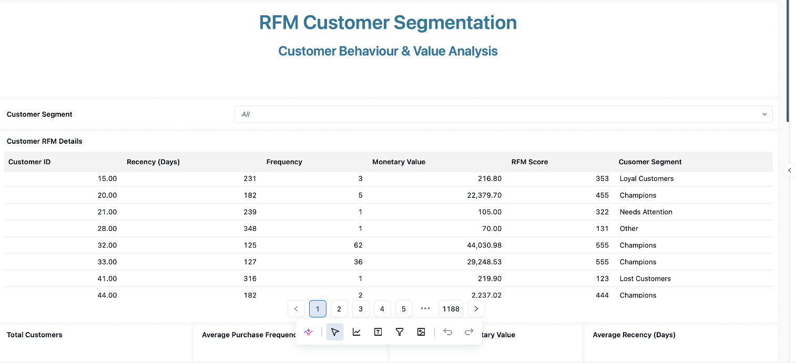
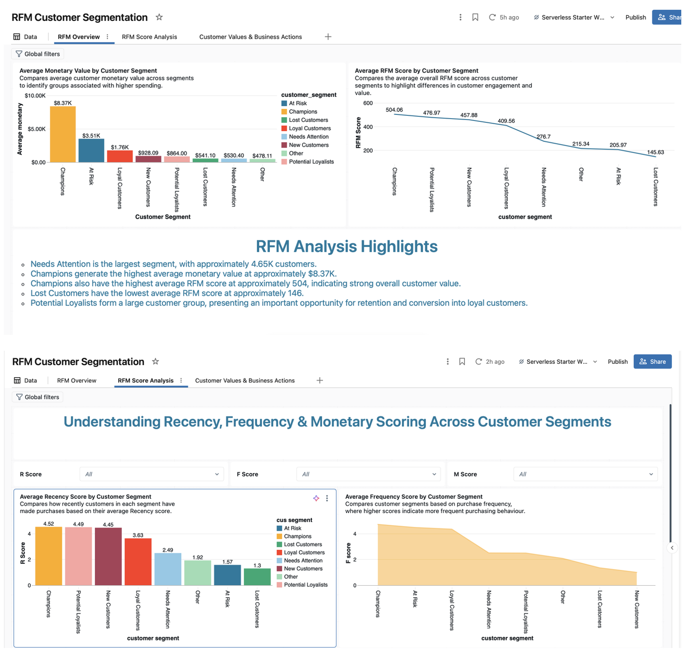
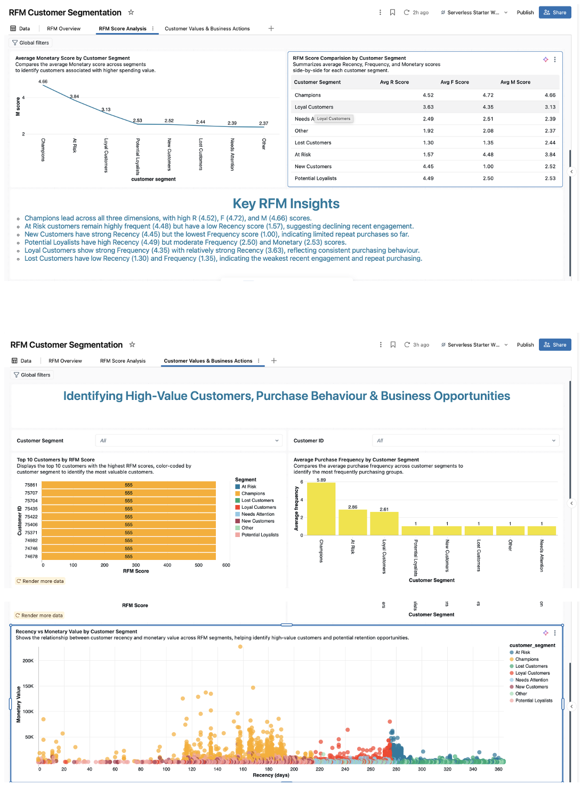

# RFM Customer Segmentation Analysis

##  Project Overview

This project focuses on understanding customer purchasing behaviour using RFM (Recency, Frequency, Monetary) analysis.

The goal is to group customers based on their purchasing patterns and explore how businesses can use these groups to improve marketing strategies and customer retention.

##  Project Objectives

* Understand customer purchasing behaviour.
* Analyze customer transactions using SQL.
* Calculate Recency, Frequency, and Monetary values.
* Identify different customer segments.
* Explore business strategies for customer retention and engagement.

## Tools Used

* SQL
* Python (PySpark)
* Databricks

##  RFM Analysis

RFM analysis uses three measurements:

Recency (R): How recently a customer made a purchase.

Frequency (F): How often a customer makes purchases.

Monetary (M): How much money a customer spends.

These measurements help businesses understand customer value and purchasing behaviour.

 ## Business Applications

RFM analysis can help businesses:

* Identify loyal and high-value customers.
* Recognize customers who may stop purchasing.
* Develop targeted marketing campaigns.
* Improve customer engagement.
* Support customer retention strategies.

## Author

Moksha Ramchetty

## Project Screenshots

### 1. Dataset Overview

### 2. Data Cleaning

### 3. RFM Calculation

### 4. Customer RFM Details

### 5. Customer Segmentation Dashboard

### 6. RFM Analysis Insights

### 7. Customer Value and Business Insights

